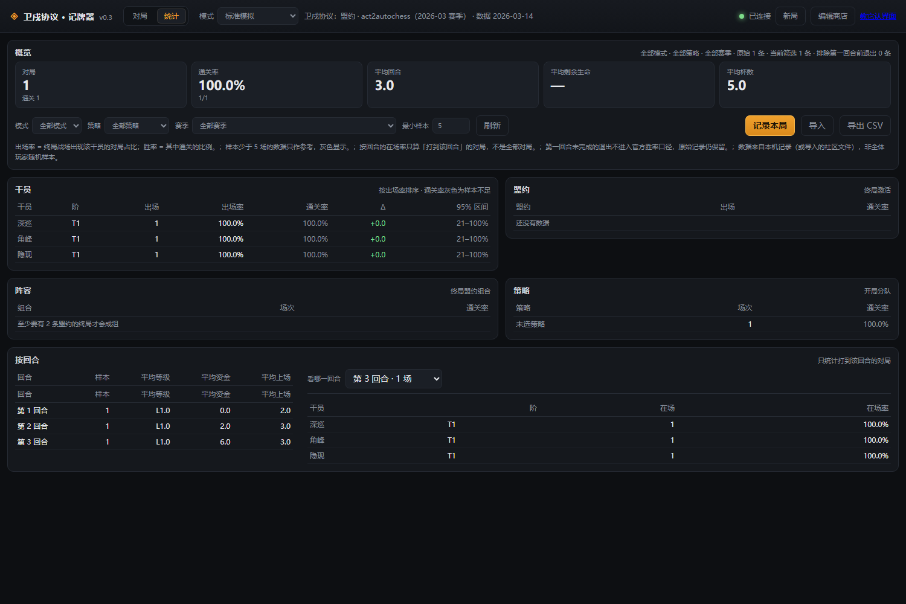

# 卫戍协议 · 记牌器（Covenant Tracker）

> **项目状态：寻找维护者 / Looking for a maintainer。** 原作者目前无力继续独立推进，希望有社区开发者接手。代码、测试、数据包、识别诊断工具和已知问题均已公开；欢迎通过 Issues 讨论或提交 PR。
>
> **当前不是开箱即用的正式服插件。** 自动识别仍需按窗口、皮肤和 UI 校准；核心计算与手工录入可用，但不要期望首次启动就能全自动同步。详见 [维护者交接说明](docs/MAINTAINER_HANDOFF.md)。
>
> 项目复盘、公开参考数据与 Screen Lens 开发历史的保留范围见 [公开归档说明](docs/ARCHIVE.md)。

给《明日方舟》「卫戍协议：盟约」做的电脑端对局助手：**卡池余量、商店命中概率、经济/升级规划、盟约层数**，一块本机网页面板搞定。

A local-first, screen-reading companion prototype for Arknights' Stronghold Protocol mode: shared-pool tracking, shop odds, economy planning, bond tracking, and match statistics. No memory reading, injection, or client modification.

```
┌─ 对局 ─────────────┬─ 概率 ──────────────┬─ 盟约 / 经济 ───────┐
│ 第 3 回合 · 休整期  │ 拉特兰 3/5  差 2 人  │ 拉特兰  ●●●○○ 3 层 │
│ 资金 7  等级 3      │ 隐现  剩 9/12  7.7%  │ 叙拉古  ●●○○○ 2 层 │
│ [商店] [商店] [ ]   │ 本刷至少一张 21.5%   │ 升级 L4：现在 8 金  │
│ 整备区 · 战场区      │ 期望 12 刷           │ 收入 4→5→6→…       │
└────────────────────┴─────────────────────┴────────────────────┘
```

## 这是什么 / 不是什么

| 是 | 不是 |
|---|---|
| 只读屏幕的**记牌器 / 计算器** | 不读游戏内存、不注入、不改客户端 |
| 手工点按也完整可用 | 不依赖识别才能工作 |
| 数据全部外置在 `packs/`，新赛季改 JSON | 不把数值写死在代码里 |
| 本机 `127.0.0.1` 网页，零安装前端 | 不是外挂；不主动上传任何数据 |

> 卫戍协议是自走棋，所以「记牌器」的形态更接近 TFT 助手：**池子还剩多少、这一刷能不能出、现在该攒钱还是升级、盟约还差几个人**。

---

## 快速开始

> 双击 `start.vbs` 可以无黑框启动（固定 8765 端口，自动开浏览器）；要看到日志就用 `run.bat`。


需要 Python 3.10+（本机是 3.12），只用标准库 + numpy + Pillow。

```bat
:: 双击也行
run.bat
```

或者手动：

```bat
cd covenant-tracker
py -3 -m covenant selftest              :: 先自检
py -3 -m covenant serve --window Arknights
```

浏览器会自动打开 `http://127.0.0.1:8765/`。

要使用独立 Windows 窗口（支持紧凑模式、置顶和窗口位置记忆）：

```bat
py -3 -m pip install -r requirements-desktop.txt
py -3 -m covenant serve --desktop --window Arknights
```

普通 `serve --window Arknights` 仍使用浏览器；桌面依赖只在这时安装。窗口偏好单独保存在 `var/desktop.json`，不会影响对局存档。不想开游戏也能看界面：

```bat
py -3 -m covenant demo
```

---

## 打包成 exe（预演）

```bat
py -3 -m pip install pyinstaller
py -3 scripts\build_exe.py
dist\CovenantTracker.exe
```

单文件约 27MB，内置网页与两个数据包；`var/` 落在 exe 旁边。
启动后右下角会出现托盘图标：双击打开面板，右键「退出」。
细节与常见问题见 [docs/PACKAGING.md](docs/PACKAGING.md)。

## 外观与桌面客户端

- 视觉层是 `covenant/ui/web/hdt.css`（钢灰 + 古金、浮雕边框、紧凑表格、自定义滚动条），加载在 `style.css` 之后；
  想换配色只改这一个文件的变量段即可，不动结构。
- 本地客户端：`py -3 -m covenant serve --desktop --window Arknights`（需要 `requirements-desktop.txt` 里的 pywebview），
  是原生 WebView 窗口，不是浏览器标签页；托盘、紧凑模式、置顶、窗口位置都会记住（`var/desktop.json`）。
- 不装 pywebview 也能用：`serve --window Arknights` 仍是浏览器，功能一致。

## 界面怎么用

### 左栏：对局

- 顶部五个数字（回合 / 资金 / 等级 / 生命 / 阶段）**点一下就能改**——识别不准时手填；
- 连接游戏窗口后默认进入「跟随游戏」：同一字段连续两帧一致且置信度达到 95% 才同步；识别缺失或不确定时保留原值并提示，不把它当作空值；
- 自动跟随只同步画面中的绝对状态，不重复扣款或结算收入。「刷新 / 升级 / 过回合」收在「手动纠错」中，暂停跟随或识别不准时使用；
- 手动纠错可明确选择普通、特殊或免费刷新；特殊刷新仍付费，免费刷新不会按概率自动触发；
- 商店证据完整、同回合同等级、阵容不变且资金变化符合规则时才记录；零扣款或策略来源无法确认的商店变化单列为「未归因」，不进实测命中率；
- 中栏底部「本局刷新」显示已确认/未确认/未归因次数、刷新类型、来源、费用及刷到的干员；
- 商店格显示规则结算后的实付价；点一张 = 买下（自动进整备区、扣钱、占卡池）；购买、出售、合成等复杂事件的自动归因仍可能需要手工纠正；
- 整备区/战场：点单位可以移动、出售、移除；
- 右上 `新局` 选模式和策略（策略自带起始生命）；
- 右上 `⚙ 设置`：调识别间隔、是否随面板自动开始；只读显示数据包与数据目录（`#settings` 可直接打开）；
- 右上 `跟随游戏`：可暂停或恢复。暂停后手动纠错区自动展开；手工值在同回合内优先于低置信度视觉覆盖。

### 中栏：概率

- 按等阶分组的池子余量；
- 每名干员：剩余份数 / 单格估计 / 本刷至少一张（独立格，允许同店重复）/ 期望刷新次数；
- 「实测命中」「命中成本」来自你自己确认过的刷新，样本够了才有意义；
- 顶部搜索框可以直接查某个干员「还差几张、值不值得刷」。

### 右栏：盟约 + 经济 + 日志

- 盟约：当前不同干员数、是否激活、还差几个到下一档、层数；
- 经济：本回合/下回合收入、实际结转规则、升级价（现在 / 下回合）、攒够钱要几回合；
- 日志：最近发生了什么（买/卖/刷/改值/识别/效果奖励），方便回溯。

### 当前规则覆盖与来源

- 数据包版本为 `2026-lower-half-community-audit-1`；界面会区分非官方复刻与社区混合来源，不能据此宣称官方客户端数值一致；
- 已接入：梓兰全部特殊刷新、杜遥夜每回合前两次特殊、佩佩升级授予特殊刷新；坎诺特资金继承与条件收入；远见层数奖励和永久购买折扣；奇迹层数奖励与免费概率展示；
- 远见／奇迹奖励由里程碑永久记账，跨档补发、重复设置和存档恢复不会重复发钱；奇迹只显示 `(18 + 0.3 × 层数)%`，不代替游戏随机判定；
- 装备、机变、免费招募、隐秘核心、多人联防仍未纳入自动化规则或概率模型，界面只提示边界；
- 默认标准模拟仍是 9 回合，其他多数模式 14 回合，湮灭 19 回合；风丸仍按两张合成。

---

## 教它认界面（识别模式）

第一次用识别，需要 5 分钟「教学」。打开右上角 **教它认界面**（`/teach`）：

1. **接窗口**：输入标题关键字（如 `Arknights`）点连接，或从下拉里选；
2. **画区域**：在截图上拖框——
   - `gold` / `shop_level` / `round` / `hp` → kind 选 `digits`；
   - 商店整排 → `shop`，格子数填 5；
   - 整备区 / 战场 → `units`，格子数填 10 / 8；
3. **学数字**：选中 `gold` 区域，输入图上的数字，点「学」。0–9 各学一次就够；
4. **学干员格**：选 `shop` 区域、格子序号、干员，点「学这一格」。每个可能出现的干员学一张；
5. **试识别**：点「识别这一帧」，右边会打印产出的观测。

学到的内容保存在 `var/profiles/<配置名>/`：

```
var/profiles/default/layout.json       区域比例坐标
var/profiles/default/ocr_digits.npz    数字字形模板
var/profiles/default/icons.npz         干员格模板
var/profiles/default/results.npz       结算（通关/失败）模板
var/profiles/default/vision.json       阈值
var/active_profile.json                当前用哪套
var/engine.json                        对局存档（与皮肤无关）
```

> 识别是**锦上添花**：认不出、认错了都不影响使用，手填永远优先。

### 认不出来的时候：识别工作台（`/lens`）

自动识别不准，先别猜，打开右上角 **识别工作台**：

- 左边是当前帧，框出每个区域（金色=数字/结算，蓝色=商店，绿色=单位），点框可高亮；
- 右边逐个区域告诉你：**读到了什么**、每个字/每格**最像的前 3 个候选**和分数、
  这一次是「识别 / 部分 / 失败 / 跳过」，以及跳过原因（比如「当前等级 L1 不用这块区域」）；
- 最下面「为什么没过 / 该教什么」会直接列硬缺口：数字缺哪几个、模板有多少、
  哪些区域的字分数偏低可能认错——**先补缺的数字**，收益最大；
- 每格都能就地教：数字填实际值点「教数字」；商店/单位点格子选干员；星级选 1/2/3；
- 四条阈值滑杆（数字 / 商店卡 / 单位 / 星级）：调低更容易认出来但更容易认错，改完立即保存；
- 顶部「模板覆盖」：0–9 十个小格，绿=已学（角标是样本数），红=缺什么，一眼看出该先补哪个；
- 「这一帧会提交什么」：预览这一帧会写进状态的观测（只读，不写入），和面板当前值不同会标黄；
- 「导出诊断」把当前帧 + `report.json` 存到 `var/reports/`（发人排查用）；「复制摘要」得到一段可直接贴出去的文本。

工作台只读诊断，不改对局状态；教出来的模板和教学页共用同一套 `var/profiles/<配置名>/`。

### 换了皮肤 / 换了分辨率怎么办

不同皮肤（比如官方要出的「乌萨斯齐心团」终端主题）会改配色、描边、HUD 底衬，
同一套数字模板未必认得出。做法是**一套皮肤一份识别配置**：

- 每套配置独立存 `layout + 数字 + 干员 + 结算 + 阈值`，互不影响；
- 换皮肤后：开 `/teach` 重新框一次区域、把数字和商店格重新学一遍（新皮肤下 5–10 分钟），
  然后「另存为新配置」，起名如 `ursus-1920`；
- 切回旧皮肤只需切换配置，不用重新学；
- 干员头像模板通常可以复用（卡面立绘不变），真正要重学的是**数字**和**结算横幅**；
- 区域坐标是比例坐标，所以 1080p / 1440p / 4K 只要比例一致就不用重框；比例不同（如带鱼屏裁切）才需要新配置。

命令行 / 接口（前端下拉由面板接）：

```bash
curl http://127.0.0.1:8765/api/profiles
curl -X POST http://127.0.0.1:8765/api/profiles/save -d "{\"id\":\"ursus\",\"name\":\"乌萨斯齐心团\"}"
curl -X POST http://127.0.0.1:8765/api/profiles/activate -d "{\"id\":\"default\"}"
```

旧版本把模板直接放在 `var/` 根下，第一次启动会自动迁到 `var/profiles/default/`，不用手动搬。

---

## 统计（pick 率 / 通关率）

顶部切到 **统计** 页。卫戍协议没有官方战绩 API，所以这里的数字来自**你自己的记录**（以及你导入的别人的记录）：

- **记录本局**：打完点一下，存终局阵容/结果/回合/生命；对局页识别到结算画面时会自动弹提示，点一下就能记；
- **出场率** = 该干员出现在终局战场的对局占比（不算整备区，避免过渡牌灌水）；
- **通关率** = 带它的对局里通关的比例；**Δ** = 相对全体通关率的差；
- **按回合**：每回合的资金/等级/上场人数与「这一回合场上都有谁」，用来判断前期该不该卖血；
- **原始 vs 筛选**：原始记录全都保留，第一回合没打完就退出的不进出口径（但仍可导出）；
- 样本少于 5 场的行标灰，并给 95% Wilson 区间——小样本别当真；
- **导入 / 导出**：JSONL 按 id 去重，可以合并别人发来的文件；CSV 给 Excel 看。



*（示意图，数据为演示用；真实样本从你的第一局开始积累。）*

详细口径与偏差说明见 [docs/STATS.md](docs/STATS.md)。

### 结算画面识别

`/teach` 的「5. 学结算画面」里，框住结算面板、分别学一张「通关」和「失败」的截图。
之后识别到结算画面，对局页顶部会出现一条提示：「识别到结算画面：通关（置信度 93%）」。

它**不会自动记账**——因为同一帧可能被重复识别，误记会污染统计。点「记录本局」才写入。

### 把统计放到网上

想收集别人的数据，用自带的收集器（纯标准库，单进程）：

```bat
py -3 -m covenant community --port 8900 --token 换成随机串
py -3 -m covenant share --url http://127.0.0.1:8900 --token 换成随机串
```

面板的统计页里也能直接传：填社区地址（会记住）→ 看一眼「本机 N 条」→ 点上传；按记录 id 去重，重复点不会重复计数。

部署、接口、隐私边界与规模化注意事项见 [docs/COMMUNITY.md](docs/COMMUNITY.md)。

---

## 上线体检

不确定现在这套配置能不能用？先跑一次体检（不连游戏）：

```powershell
py -3 -m covenant doctor
py -3 -m covenant doctor --frames var/demo_frames   # 顺便回放截图
```

它会检查数据包、布局区域、数字/干员/结算模板、商店格数覆盖、识别阈值，缺什么、怎么补都写在输出里。官方上线当天的完整步骤见 [docs/LAUNCH_CHECKLIST.md](docs/LAUNCH_CHECKLIST.md)。

## 私服联调（v1.0）

官方上线前，可以拿同人复刻的网页私服练识别：HUD 120/120 一致，商店卡 95% 命中（72/76）、0 错认，认不出的返回 unknown；L1/L2 两种格数各有布局。完整步骤见 [docs/PRIVATE_SERVER.md](docs/PRIVATE_SERVER.md)。

```powershell
py -3 -m covenant serve --frames var/demo_frames --port 8801   # 回放截图，不用开游戏
py -3 -m covenant serve --window Arknights                     # 抓官方客户端窗口

py -3 scripts\calibrate_priv.py var\fixtures\priv   # 学 HUD 数字
py -3 scripts\replay_priv.py   var\fixtures\priv    # 截图 → 状态，和 DOM 真值比对

py -3 scripts\install_private_templates.py          # 装私服布局与模板
py -3 scripts\export_templates.py                   # 导出当前校准，换机器/给朋友
```

已归档的布局预设：`data/layouts/private-1600x900.json`。私服布局只能当参考，官方客户端上线后要在 `/teach` 里重标。

## 11/8 上线后的检查清单

1. **先跑 `py -3 -m covenant selftest`**，确认框架没坏；
2. 打开游戏 → `/teach` 重新标区域（新 UI 大概率要重标）；
3. 重学数字（字体/颜色变了就重学）；
4. 商店格每格学一遍当前赛季会出现的干员；
5. 对照游戏核对 `packs/act2autochess/pack.json` 的：收入、升级价、商店格数、卡池份数；
6. 盟约阈值若有变，改 `bonds.json` 的 `activate_at` / `thresholds`；
7. 多人局记得用 `rules.pool_extra` 补记队友拿走的份数（界面后续会加面板）。

发现哪里不对，优先改 `packs/` 里的 JSON 并点「重载数据包」，而不是改代码。

---

## 目录

```
covenant/           源码（capture → vision → state → calc → ui，逐层依赖）
covenant/stats/     战绩记录、存储、聚合
covenant/community/ 社区收集器 + 上传客户端
packs/              赛季数据包
scripts/            数据包生成脚本
tests/              Python 单元测试 + 前端语法与契约检查（数量以当次测试输出为准）
docs/ARCHITECTURE.md 架构、模型假设、扩展点
docs/DATA_PACK.md    数据包字段与改法
docs/STATS.md        pick/win 率的口径与偏差
docs/COMMUNITY.md    把统计放到网上的部署说明
docs/REVIEW.md       整体复查：弱点、效率、优先级
docs/COLLABORATION.md 两人一机的协作约定（信箱、合并流程）
docs/v0.3-core-trustworthy-design.md  事件账本 / 刷新分析的设计说明
docs/V2_PLAN.md      插件化 / 打包 / 社区汇总的规划
docs/LAUNCH_CHECKLIST.md 上线当天的校准步骤
docs/MAINTAINER_HANDOFF.md 当前完成度、已知限制与接手优先级
tools/screen-lens/    独立的截图识别诊断工具（MIT）
var/                运行时产物（可删，不提交）
run.bat             一键启动
```

## 测试

```bat
python scripts\check_all.py --frames var\demo_frames   :: 一条命令跑完全部门禁
py -3 -m unittest discover -s tests -v
py -3 -m covenant selftest
node tests/test_frontend.js
node tests/test_plugin_interface.js
node tests/test_desktop_frontend.js
```

`check_all.py` 依次跑：编译 → 全部单测 → `node --check` 三个前端文件 → `covenant doctor`
（编译/单测/doctor 任一失败都会以非零退出码结束）。改完代码、交给外部审查之前先跑它。

测试覆盖：数据包校验、卡池消耗、独立格概率、经济曲线与资金清零、回合结算、手工值优先、事件账本（追加/去重/重放/损坏拒绝）、刷新实测、数字识别、模板匹配、识别管线、战绩存储/聚合/导入导出、回合计时间线、结算提示、社区聚合与记录校验。

---

## 数据来源与免责

- 框架与识别层：本项目原创；
- 赛季数值：来自社区逆向文档 [Stronghold-Protocol](https://github.com/sganggs/Stronghold-Protocol)（GPL-3.0，非官方同人复刻），并标注了置信度（`data`/`wiki`/`community`/`assumed`）；
- 官方公告：[卫戍协议：盟约](https://ak.hypergryph.com/news/5114)；
- 抽卡模型（每格独立、按剩余份数加权、允许同店重复）来自同人私服 `server/match/pool.js` 的实现，**官方未公布**；如果正式服实测不符，换 `calc/odds.py` 里的模型即可；
- 收入上限 12、回合结束未花完的资金清零，同样以私服 `data/config.json` 为准（早期社区文档写的 10 已被替换）。

本项目是非官方工具，不与鹰角网络/上海鹰角网络科技有限公司关联。请遵守游戏用户协议，仅将屏幕识别用于个人辅助。

---

## 路线图

- [x] 数据包 + 卡池/概率/经济/盟约
- [x] 状态机（买/卖/刷/升/过回合/三合一）+ 手工纠错
- [x] 屏幕采集（窗口）+ 数字/格子识别 + 教学页
- [x] 本机网页面板 + demo 模式
- [x] 战绩记录 + pick/win 率 + 导入导出（v0.2）
- [x] 结算界面识别（判通关/失败，不自动记账）+ 按回合统计（v0.3）
- [x] 社区收集器（`covenant community` / `covenant share`）
- [x] 快照 ETag（304）+ 回环/CORS 收紧
- [x] 逐局事件账本（JSONL + fsync + 重放）+ 刷新实测分析（v0.3 core）
- [x] 独立格抽卡模型（私服 `pool.js` 确认：允许同店重复）
- [ ] 结算界面的杯数与最终等级识别
- [ ] 置顶小窗（`ui/overlay.py`）
- [ ] 精锐角标识别（自动判 2 星）
- [ ] 装备格识别
- [ ] 多人共享池面板 + 队友阵容
- [ ] 商店候选剪枝（按等阶先过滤模板）
- [ ] 打包成单文件 exe
- [ ] 对局录像/回放（快照本身就是 JSON，导出即可）

### 整备区 / 战场 / 星级（模板已支持，教学页按钮待接）

单位卡的尺寸和构图跟商店卡不同，所以模板单独存在 `units.npz`；星级角标单独存 `stars.npz`。
布局里的单位区域可以带这些参数：

```jsonc
{"kind": "units", "params": {
  "slots": 10,                    // 整备区 10 / 战场 8
  "art": 0.7,                     // 只取上半部分（避开名字与星级）
  "star_rect": [0.0, 0.7, 1.0, 0.3]  // 星级角标在格子内的相对位置
}}
```

接口（教学页按钮由前端接）：

```bash
# 学一个单位（region 用 bench / board 之类）
curl -X POST http://127.0.0.1:8765/api/vision/learn-unit \
  -d "{\"region\":\"bench\",\"index\":0,\"op_id\":\"chess_char_2_11_a\"}"
# 学星级（1/2/3）
curl -X POST http://127.0.0.1:8765/api/vision/learn-star \
  -d "{\"region\":\"bench\",\"index\":0,\"star\":3}"
```

没学过星级时一律按 1 星处理；没学过的干员不会硬猜，仍按「未知」处理。

---

## 参与和许可

- 想接手或协助，请先读 [维护者交接说明](docs/MAINTAINER_HANDOFF.md) 与 [贡献指南](CONTRIBUTING.md)，然后通过 GitHub Issues 留言。
- 根项目采用 [GPL-3.0](LICENSE)，以兼容数据与规则来源中的 GPL-3.0 同人复刻。
- `tools/screen-lens/` 保留其独立的 [MIT 许可](tools/screen-lens/LICENSE)。
- 本项目与游戏官方无关；游戏名称、素材和商标归各自权利人所有。
