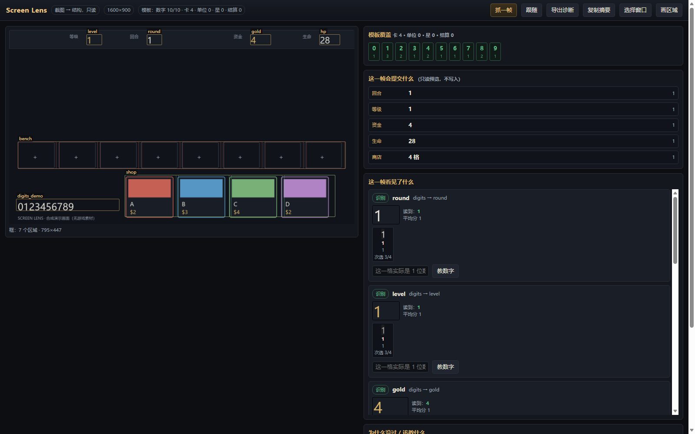

# Screen Lens

**截图 → 结构。** 一个只读的「画面识别诊断台」：告诉你每个区域读到了什么、每个字最像什么、为什么被阈值挡住、以及怎么教它。

它不是自动化工具，也不读游戏内存——只吃截图，输出可检查的识别结果。



> 演示用的是 `tools/make_samples.py` 生成的合成画面（没有游戏素材），所以模板覆盖率是满的。接入真实游戏后，你看到的会是红色和「缺 0/5/6/7/9」这类具体结论。

## 为什么做这个

写游戏识别的人都有同一个痛点：**认不出来的时候，不知道是哪一步坏了**。

- 是区域框错了？
- 是字没学过？
- 是阈值太高？
- 是这一格的卡面根本没进模板库？

大多数工具只回一个 `None`。Screen Lens 把中间过程全部摊开：逐字候选、逐格候选、分数、跳过原因、模板覆盖率，以及一句「你现在该补什么」。

## 能做什么

- **三种输入**：窗口标题（实时）、截图目录（回放）、网页里点「选择窗口」
- **四类区域**：数字（digits）、商店格（shop）、单位格（units）、结算（result）
- **逐字/逐格候选**：每个字给 top-3；每个卡格给 top-3，并标出是否过阈值
- **就地教学**：数字直接填、卡格点候选、单位填 id、星级点角标；模板立刻生效
- **阈值滑杆**：数字/卡面/单位/星级四条，改完自动保存
- **画区域**：在截图上拖一个框，起名、选类型，直接写进 `layout.json`
- **导出诊断**：当前帧 PNG + 完整报告 JSON，方便贴 issue
- **只读**：不改游戏、不注入、不读内存、不自动操作

## 快速开始

```bash
pip install -r requirements.txt

# 1) 生成演示截图（合成画面，无版权问题）
python tools/make_samples.py

# 2) 起诊断台（回放两张演示图）
python -m screenlens serve --samples samples --layout layouts/mock.json --var var
```

打开 <http://127.0.0.1:8765>。

接真实窗口：

```bash
python -m screenlens serve --window "你的窗口标题的一部分"
```

然后在页面上点 **抓一帧**。窗口必须可见（不能最小化），建议无边框窗口化。

## 第一次用，按这个顺序

1. **画区域**：在截图上拖框 → 起名（如 `gold`）→ 类型选 `digits`；
2. **教数字**：在右栏该区域点「教数字」，输入这一格真实的数字（几位就填几位）；
3. **教卡面**：商店/单位区域点某一格 → 填入一个 id（如 `firefly`）；
4. **看建议**：右下角「为什么没过 / 该教什么」会按优先级告诉你还缺什么；
5. **调阈值**：认错多就把阈值调高，认不出多就调低。

布局是普通 JSON（`var/layout.json`），区域坐标都是**比例**，所以同一套布局在 1080p/1440p 下通用；不同皮肤/分辨率建议各存一份目录（`--layout` 或换 `--var`）。

## 它是怎么认的

1. **区域**：`roi.py` 里的 `Rect` 用 0~1 比例存坐标；
2. **数字**：列投影切字 → 归一化成 20×28 → 与已学模板算余弦相似度，取最高分；
3. **卡面/单位**：裁出卡面上部 → 缩放到 48×64 → 减均值归一化 → 在 ±6% 的平移范围内找最佳匹配；
4. **判定**：分数 ≥ 阈值才算「认出来」，否则老老实实返回 unknown，并给出 top-3 供你判断。

商店或单位区域可在 `params` 中设置 `"auto": true`：先用 `detect_runs` 按内容块切分，找不到可靠内容块时回退到固定槽位。`min_w` / `max_w` 可调整候选宽度比例；`detect_row.py` 是归档保留的等距行切分实验，尚未接入默认管线。`tools/detect_demo.py` 可在截图上预览自动切格结果。

## 已知限制

- 数字要求同字体、同字号；换字体要重学（这正是它要帮你发现的事）；
- 不做透视矫正、不做旋转、不做多语言数字；
- 单位/星级需要你先教过，没教过会按 1 星显示；
- 只支持 Windows（抓窗口用 `PrintWindow`/`BitBlt`）；
- 没有自动操作，也不会替你点游戏。

## 我需要帮助

这个工具是从一个具体项目里抽出来的，我手里只有一种 UI 的样本。如果你愿意帮忙：

- **素材**：任意游戏/软件的截图 + 你希望识别的区域说明（分辨率、字体、是否高分屏）；
- **布局**：把你调好的 `layout.json` 发我，我可以做一个「布局库」；
- **踩坑**：哪种情况下它认不出来、你怎么绕过去的——这些比 star 有用。

## 目录

```
screenlens/
  capture/   窗口抓取（ctypes，纯只读）、目录回放、合成源
  vision/    区域定义、数字 OCR、模板匹配、识别管线、诊断报告
  web/       单页诊断台
  server.py  stdlib HTTP，无第三方 Web 框架
tools/       生成演示素材 / 学演示模板
```

## License

MIT
